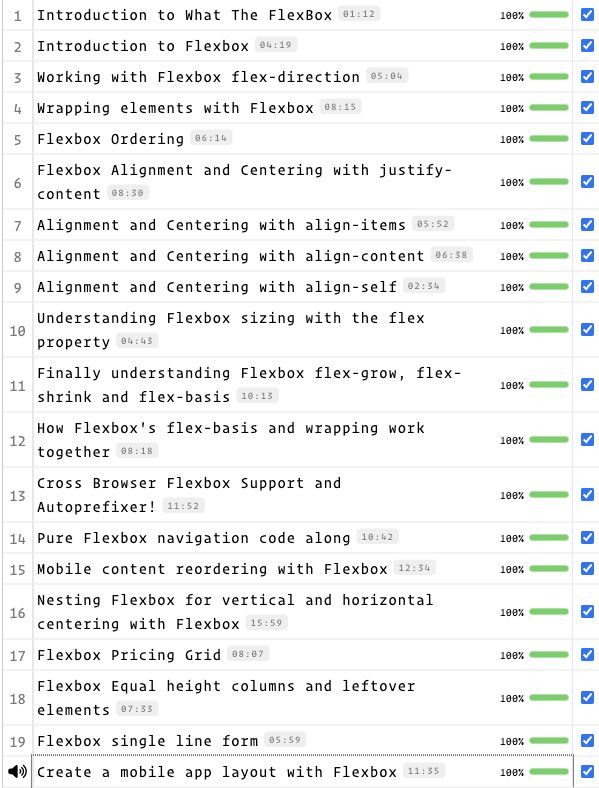

# Завдання 2 — What The Flexbox?!

Практичні вправи курсу [Wes Bos](https://flexbox.io/), лабораторна робота №7.

Структура відповідає наданому прикладу: 15 тематичних папок, які охоплюють 20 відеоуроків. Кілька уроків розвивають ту саму вправу.

## Запуск

Відкрити [index.html](index.html) у браузері. Для статичних вправ не потрібні збірка або UI-бібліотеки.

## Відповідність урокам

| Урок | Тема | Код |
| --- | --- | --- |
| 1 | Огляд курсу | Оглядовий урок без окремої вправи |
| 2 | Flex-контейнер | [intro](intro/index.html) |
| 3 | Напрямок | [flex-direction](flex-direction/index.html) |
| 4 | Перенесення | [flex-direction/wrapping](flex-direction/wrapping.html) |
| 5 | Порядок | [ordering](ordering/index.html) |
| 6 | justify-content | [alignment-and-centering/lesson-06](alignment-and-centering/lesson-06.html) |
| 7 | align-items | [alignment-and-centering/lesson-07](alignment-and-centering/lesson-07.html) |
| 8 | align-content | [alignment-and-centering/lesson-08](alignment-and-centering/lesson-08.html) |
| 9 | align-self | [alignment-and-centering/lesson-09](alignment-and-centering/lesson-09.html) |
| 10 | flex | [flexbox-sizing](flexbox-sizing/index.html) |
| 11 | grow, shrink, basis | [flex-grow-and-shrink](flex-grow-and-shrink/index.html) |
| 12 | basis і перенесення | [flex-wrapping-and-columns](flex-wrapping-and-columns/index.html) |
| 13 | Autoprefixer | [autoprefixer](autoprefixer/index.html) |
| 14 | Навігація | [flexbox-nav](flexbox-nav/index.html) |
| 15 | Мобільний порядок блоків | [mobile-reordering](mobile-reordering/index.html) |
| 16 | Вкладені flex-контейнери | [nesting-flexbox](nesting-flexbox/index.html) |
| 17 | Тарифні картки | [pricing-grid](pricing-grid/index.html) |
| 18 | Однакова висота | [equal-height-elements](equal-height-elements/index.html) |
| 19 | Форма в рядок | [flexbox-form](flexbox-form/index.html) |
| 20 | Макет застосунку | [flexbox-app-layout](flexbox-app-layout/index.html) |

## Урок 13: реальна збірка

У папці `autoprefixer` встановити залежності через `npm install`, потім виконати `npm run build` або `node gulpfile.js`. Результат — `build/styles.css`.

`gulpfile.js` відтворює ланцюжок PostCSS → Autoprefixer напряму на сучасному Node.js, без несумісної старої версії Gulp. Згенерований CSS включений до репозиторію, тому приклад відкривається без встановлення залежностей.

## Джерело та зміни

Вихідні вправи: [wesbos/What-The-Flexbox](https://github.com/wesbos/What-The-Flexbox), ревізія `93da0642349f213be4c38457a73eedfee82bfc23`. Автор навчальних матеріалів — Wes Bos.

Збережено структуру вправ і вихідні START-файли. У готових варіантах виправлено посилання на CSS, додано viewport, Google Fonts, reset, CSS-змінні, видимий фокус і доступні підписи. jQuery та Font Awesome вилучено. У вправі з однаковою висотою текст пісні замінено нейтральними фразами; задача розкладки та різні розміри елементів збережені.

## Результат на сайті курсу

Станом на 3 листопада 2026 року сторінка акаунта показує **100% для всіх 20 уроків**. Нижче — знімок фактичного стану сайту.

[Повний контекст сторінки курсу](screenshots/course-context.jpg).

## Матеріали для захисту

[Короткий конспект 20 уроків](LESSON-NOTES.md) · [Результати перевірки коду](VERIFICATION.md).

Код вправ і стан прогресу на сайті — окремі результати. Скриншот фіксує показаний сайтом прогрес і не є окремою перевіркою засвоєння матеріалу.

## Урок 1. Вступ до курсу

Огляд цілей курсу та інструментів. Окремої вправи з кодом у цьому відео немає; перша практична вправа починається з уроку 2.

## Підписи уроків

У [списку](index.html) є всі 20 пронумерованих уроків. На сторінці кожної вправи зазначено номер і назву; README папок містять відповідність урокам.
