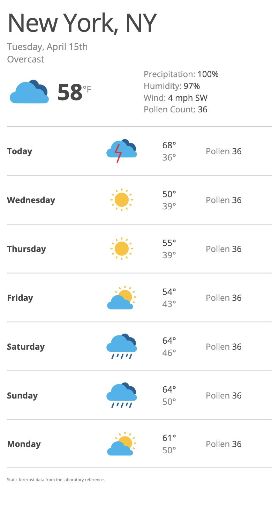

# Завдання 3 — Макет прогнозу погоди

Відтворено зразок погодного застосунку з лабораторної роботи №7: поточна погода в New York та прогноз на 7 днів.

## Запуск

Відкрити [index.html](index.html) у браузері або запустити `python3 -m http.server 8000` у цій папці.

## Реалізація

- HTML5 та CSS без JavaScript і сторонніх UI-бібліотек.
- Розкладка на Flexbox: поточна погода, список днів і чотири колонки кожного дня.
- Reset стилів у `reset.css`, CSS-змінні в `:root`.
- Шрифт Open Sans із Google Fonts, `display=swap`.
- Оригінальні погодні іконки з папки `icons` методички.
- Медіазапит зменшує елементи прогнозу на вузьких екранах; поточні умови переносяться у стовпець.
- Температури й показники повторюють навчальний зразок. Це статичні дані, а не поточний прогноз погоди.

## Як змінити кількість днів

Додати або прибрати елемент `<li class="day">` у списку `.forecast`. Flexbox автоматично розмістить довільну кількість рядків.

## Джерело завдання

[Лабораторна робота №7](https://github.com/Computer-Science-Department-ChNU/web-technologies/blob/main/html-css/labs/lab-07/lab-07.adoc) · [Зразок макета](https://github.com/Computer-Science-Department-ChNU/web-technologies/blob/main/html-css/labs/lab-07/task-8_1.png) · [Іконки](https://github.com/Computer-Science-Department-ChNU/web-technologies/tree/main/html-css/labs/lab-07/icons).

## Перевірка та скриншоти

Перевірено ширини 320, 375, 768 та 1280 px: усі сім днів і зображення відображаються, горизонтального переповнення немає. Локальні CSS та іконки знайдено.

[Мобільна версія](screenshots/mobile.jpg).
